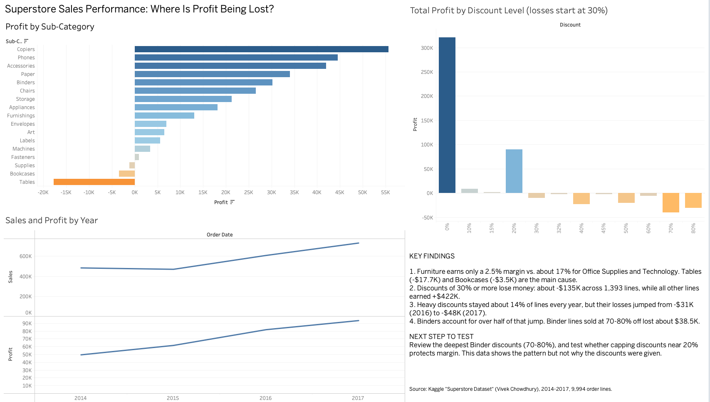
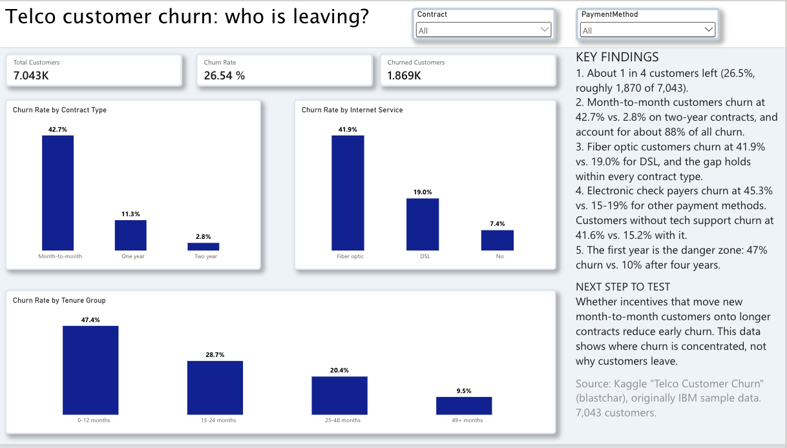
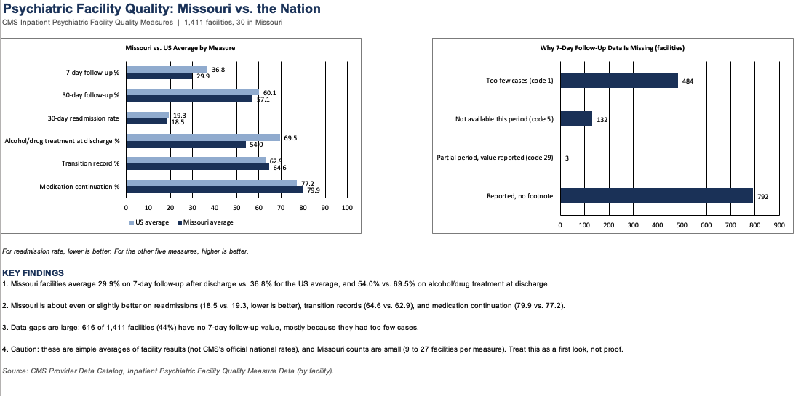

Business Data Analytics Portfolio

Welcome to my Business Data Analytics Portfolio!

I’m a Business Administration student at the University of Missouri–Kansas City (UMKC) with an emphasis in Data Analytics. I’m interested in using data to solve business problems, identify trends, and support better decision-making.

About Me

* 🎓 Business Administration student at UMKC
* 📊 Interested in Business Intelligence and Data Analytics
* 📈 Interested in data visualization and business reporting
* 💡 Continuously developing my technical and analytical skills

## Technical Skills
| Tool | Where I've used it |
|---|---|
| Microsoft Excel | All 3 projects: data cleaning, PivotTables, formulas, charts |
| SQL | Projects 1 and 3: filtering, grouping, joins-style summaries, SQLite |
| Power BI | Project 2: interactive dashboard with filters and a DAX measure |
| Tableau | Project 1: interactive dashboard |
| R | Coursework |
| Python | Currently learning |

Portfolio Projects

I am building projects that demonstrate my ability to collect, clean, analyze, and visualize data to generate meaningful business insights.

1. Sales Performance Analysis

**Status: Complete** | [View the interactive dashboard on Tableau Public]((https://public.tableau.com/app/profile/abisai.montes/viz/SuperstoreSalesPerformance_17946991080290/Dashboard1))

**Business question:** Where is this retail company making and losing money?

**Key findings**
- Furniture earns only a 2.5% profit margin vs. about 17% for Office Supplies and Technology. Tables and Bookcases are the main cause.
- Discounts of 30% or more lose money: about -$135K across 1,393 order lines, while all other lines earned +$422K.
- Heavy discounts stayed about 14% of lines every year, but their losses jumped from about -$31K (2016) to -$48K (2017). Binders account for over half of that jump.
- Binder lines sold at 70-80% off lost about $38.5K.

**Tools used:** Excel (cleaning), SQL with SQLite (analysis), Tableau Public (dashboard), GitHub

**Project files**
- [Data dictionary](project1/data_dictionary.md)
- [Data cleaning log](project1/cleaning_log.md)
- [SQL queries](project1/project1_queries.sql)

**Data source:** Kaggle "Superstore Dataset" by Vivek Chowdhury (public sample data, 2014-2017)

2. Telco Customer Churn Analysis
**Status: Complete** | [View the project](project2-customer-churn/readme.md)

**Business question:** Which customers are leaving, and what do they have in common?

**Headline finding:** About 1 in 4 customers left. Month-to-month customers churn at 42.7% vs. 2.8% on two-year contracts, and customers in their first year churn at 47% vs. 10% after four years.

**Tools used:** Excel (cleaning, PivotTables), Power BI (dashboard, DAX measure)

3. Psychiatric Facility Quality: Missouri vs. the Nation (Healthcare)
**Status: Complete** | [View the project](project3-psychiatric-facility-quality/readme.md)

**Business question:** How do Missouri's psychiatric facilities compare with the national picture on follow-up care, treatment at discharge, and readmissions?

**Headline finding:** Missouri facilities average 29.9% on 7-day follow-up after discharge vs. 36.8% nationally, and 54.0% vs. 69.5% on alcohol/drug treatment at discharge. About 44% of facilities have no 7-day follow-up value, mostly because they had too few cases.

**Tools used:** Excel (formulas, charts), SQL with SQLite, GitHub

Career Goal

My goal is to combine business knowledge and technical analytics skills to help organizations make informed, data-driven decisions.

⸻

Thank you for visiting my portfolio!
