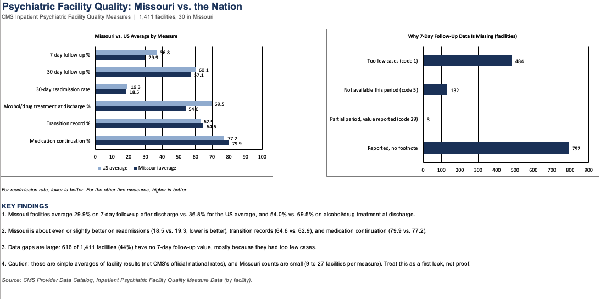

# Project 3: Psychiatric Facility Quality, Missouri vs. the Nation

**Business question:** How do Missouri's psychiatric facilities compare with the national picture on follow-up care, treatment at discharge, and readmissions?

**Key findings**
- Missouri facilities average 29.9% on 7-day follow-up after discharge vs. 36.8% nationally, and 54.0% vs. 69.5% on alcohol/drug treatment at discharge.
- Missouri is about even or slightly better on readmissions, transition records, and medication continuation.
- 44% of facilities have no 7-day follow-up value, mostly because they had too few cases.

**Limits:** These are simple averages of facility results, not CMS's official national rates. Missouri counts are small (9 to 27 facilities per measure), so this is a first look, not proof.

**Tools used:** Excel (formulas, charts), SQL with SQLite, GitHub

**Project files**
- [Data dictionary](data_dictionary.md)
- [Data cleaning log](cleaning_log.md)
- [SQL queries](project3_queries.sql)
- [Excel workbook with dashboard](psych_quality_analysis.xlsx)

**Data source:** CMS Provider Data Catalog, Inpatient Psychiatric Facility Quality Measure Data (by facility), public data.
